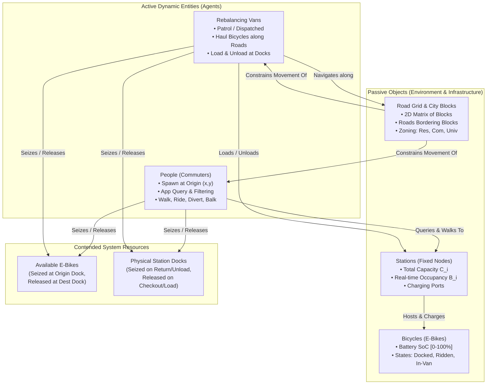
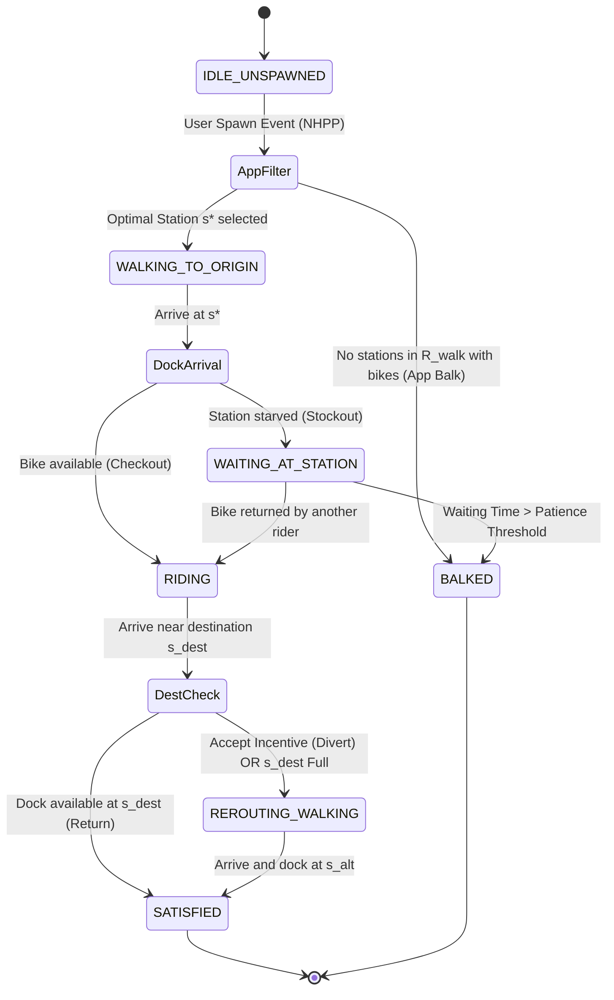
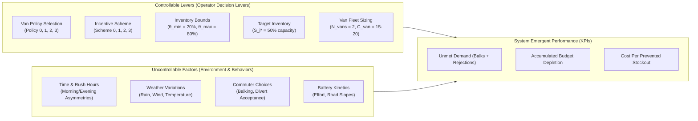
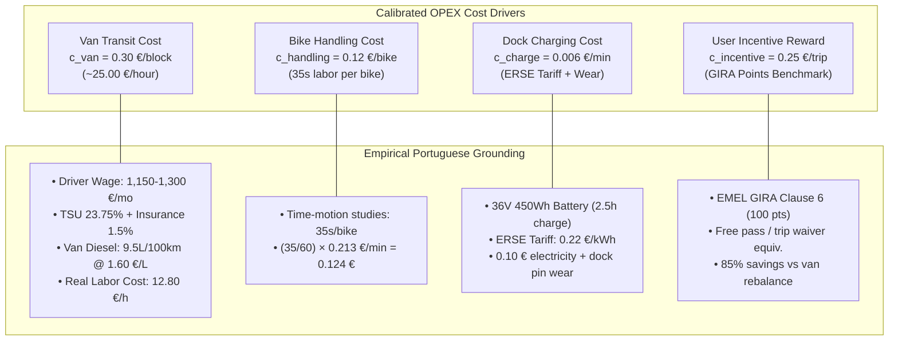
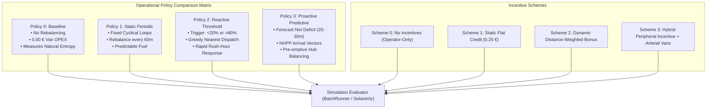
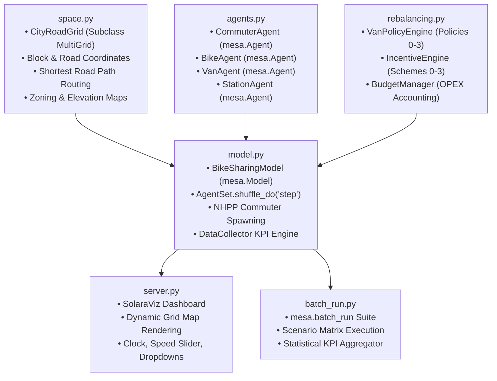
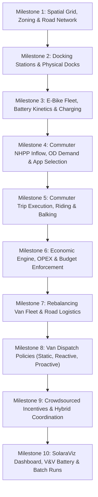

# Master Specification Blueprint: Urban Bike-Sharing Fleet Rebalancing & Incentive Optimization

> **Authoritative Specification & System Knowledge Base**  
> **Course Lifecycle Alignment:** Systems Modelling & Simulation (FEUP MS)  
> **Simulation Engine:** Modern Mesa 3.x (`mesa >= 3.0.0`) & SolaraViz  
> **Domain Calibration:** Porto Central Core Micromobility Network  
> **Reference File Ingested:** `MS - Project Guide` (FEUP MS Course Document)

---

## 1. Executive Summary & Formal Optimization Problem

### 1.1 Problem Statement & Background Context
In a dock-based electric bike-sharing system (BSS), asymmetric commuter flows between residential neighborhoods, commercial/central business districts (CBD), and university/industrial poles create acute spatiotemporal supply-demand imbalances. During peak commuting windows (morning rush and evening rush), these asymmetric flows cause:
1. **Origin Stockouts (Starvation):** Origin stations in residential or transit-origin areas are depleted to 0 bikes ($B_i(t) = 0$), forcing arriving commuters to balk or abandon the system.
2. **Destination Rejections (Saturation):** Destination stations in commercial, university, or employment centers reach maximum physical capacity ($B_i(t) = C_i$), rejecting arriving cyclists who must then make detour walks to find open docks.

Physical rebalancing via service vehicles (vans) incurs heavy operational expenditures (OPEX) including light-commercial vehicle fuel, vehicle leasing/depreciation, and municipal driver wages. Concurrently, public micromobility systems operate under strict municipal operational budget ceilings. 

**Core Research & Engineering Question:**
$$\text{“Given a constrained operational budget, what dispatching and rebalancing policy for a fleet of service vehicles}$$
$$\text{minimizes unmet commuter demand caused by spatiotemporal imbalances in an urban bike-sharing network?”}$$

To address this challenge, the system explores two complementary mechanisms:
* **Dynamic Operator-Driven Rebalancing:** Physical service vans dispatched according to static loops, reactive inventory thresholds, or forward-looking predictive demand queues.
* **Crowdsourced User Incentives:** Monetary discounts or bonus ride credits that incentivize flexible commuters to divert their drop-offs to underfilled stations or pick-ups from saturated stations, substituting expensive van logistics with low-cost commuter self-rebalancing.

---

### 1.2 Formal Mathematical Optimization Problem
The prescriptive objective is to minimize total unmet commuter demand—constituting both origin balks and destination diversion penalties—across a defined operational shift horizon $T = 720\text{ minutes}$ (12 daylight hours, 07:00 to 19:00), subject to physical dock capacities, vehicle payload capacities, walking tolerance bounds, and a hard cumulative budget ceiling.

#### Objective Function:
$$\min_{\pi_{\text{van}}, \pi_{\text{inc}}} \mathcal{Z} = \sum_{t=1}^{T} \left( \sum_{p \in \mathcal{P}_{\text{spawn}}(t)} \mathbb{I}_{\text{balk}}(p, t) + \gamma_{\text{walk}} \sum_{p \in \mathcal{P}_{\text{arrive}}(t)} d_{\text{detour}}(p, t) + \gamma_{\text{wait}} \sum_{p \in \mathcal{P}_{\text{wait}}(t)} \Delta t \right)$$

Where:
* $\pi_{\text{van}}$ is the selected van dispatching and routing policy ($\text{Policy } 0, 1, 2, \text{ or } 3$).
* $\pi_{\text{inc}}$ is the crowdsourced user incentive scheme ($\text{Scheme } 0, 1, 2, \text{ or } 3$).
* $\mathcal{P}_{\text{spawn}}(t)$ is the set of commuters generated at minute $t$.
* $\mathbb{I}_{\text{balk}}(p, t) \in \{0, 1\}$ is an indicator function taking value $1$ if commuter $p$ encounters no available, charged bikes within walking radius $R_{\text{walk}}$ and immediately balks.
* $\mathcal{P}_{\text{arrive}}(t)$ is the set of commuters reaching their intended destination dock at minute $t$.
* $d_{\text{detour}}(p, t)$ is the excess walking distance (in grid blocks or meters) imposed on rider $p$ due to destination dock saturation.
* $\gamma_{\text{walk}}$ is the penalty weight converting excess walking blocks into equivalent unmet service units.
* $\mathcal{P}_{\text{wait}}(t)$ is the set of commuters actively waiting at docks.
* $\gamma_{\text{wait}}$ is the penalty weight for commuter wait duration.

#### System Constraints:
1. **Station Dock Inventory Bounds:**
   $$0 \le B_i(t) \le C_i, \quad \forall i \in \{1, \dots, N_{\text{stations}}\}, \quad \forall t \in [0, T]$$
   Station inventory $B_i(t)$ cannot be negative (no backorders at docks) and cannot exceed the physical dock count $C_i$.

2. **Rebalancing Vehicle Capacity Bounds:**
   $$0 \le L_v(t) \le C_{\text{van}}, \quad \forall v \in \{1, \dots, N_{\text{vans}}\}, \quad \forall t \in [0, T]$$
   The bicycle payload $L_v(t)$ onboard van $v$ cannot exceed its physical cargo capacity $C_{\text{van}} \in [15, 20]$.

3. **Commuter Walking Radius Cutoff ($R_{\text{walk}}$):**
   Commuters only consider candidate stations $s_k$ whose spatial distance from their spawn origin satisfies:
   $$\text{dist}(\text{origin}_p, s_k) \le R_{\text{walk}}$$
   If no station with an available, charged bike ($B_{s_k}(t) > 0$) exists within $R_{\text{walk}}$, the user balks immediately without walking.

4. **Hard Shift Budget Constraint:**
   $$\text{OPEX}(t) \le B_{\text{max}} = 180.00\text{ EUR}, \quad \forall t \in [0, T]$$
   Where cumulative operational expenditure is governed by:
   $$\text{OPEX}(t) = \sum_{\tau=1}^{t} \left( c_{\text{van}} \cdot \sum_{v=1}^{N_{\text{vans}}} d_v(\tau) + c_{\text{handling}} \cdot n_{\text{handled}}(\tau) + c_{\text{charge}} \cdot m_{\text{charging}}(\tau) + c_{\text{incentive}} \cdot n_{\text{awarded}}(\tau) \right)$$
   Once $\text{OPEX}(t) \ge B_{\text{max}}$, all active van dispatches are suspended (vans return to depot, travel costs drop to zero) and user incentive rewards are deactivated.

---

### 1.3 Modeling Lifecycle & System Classification
According to the FEUP Systems Modelling & Simulation (FEUP MS) lifecycle, this system is modeled across six disciplined phases:
1. **Assumed System:** Urban dock-based e-bike sharing across heterogeneous urban zones (residential, commercial/CBD, university/industrial) in Porto, Portugal.
2. **Conceptual Model:** Ontological abstraction into active agents, passive physical infrastructure, contended resources, discrete events, and continuous activities.
3. **Logical Model:** Algorithmic flowcharts, candidate station filtering, utility-minimizing station choice, van dispatch state machines, and battery charging logic.
4. **Modern Mesa Translation:** Direct architectural mapping into Mesa 3.x (`mesa.Model`, `mesa.Agent`, `AgentSet.shuffle_do()`, custom grid-road topologies).
5. **Verification & Validation (V&V):** Assertion-based invariant checking (conservation of total bicycles, dock occupancy non-negativity, budget monotonicity) and empirical benchmark grounding against Lisbon's GIRA and Portuguese ERSE tariffs.
6. **Experimental Design:** Multi-factorial scenario matrix comparing baseline operations against static, reactive, and proactive policies under varying budget limits and commuter willingness parameters.

---

## 2. Ontological System Breakdown (Course Lifecycle)



### 2.1 Dynamic Entities & Attribute Taxonomy
Dynamic entities are active decision-makers or operational units that alter system state, traverse the spatial topology, and interact with resources.

#### Entity 1: `People` (Commuters / Users)
* **Description:** Autonomous individual commuters moving between urban zones according to daily work, study, and leisure routines.
* **Attributes:**
  * `id` (`int` / `str`): Unique entity identifier.
  * `origin_coord` (`Tuple[int, int]`): Continuous/grid coordinate of commuter spawn point.
  * `destination_coord` (`Tuple[int, int]`): Continuous/grid coordinate of intended target destination.
  * `assigned_origin_station_id` (`int`): Station ID selected via app query.
  * `assigned_dest_station_id` (`int`): Station ID targeted for drop-off.
  * `walking_distance` (`float`): Accumulated walking distance (access walk + detour walk).
  * `waiting_time` (`int`): Accumulated ticks spent waiting at an empty dock before balking.
  * `patience_threshold` (`int`): Maximum waiting tolerance sampled from user distribution ($\bar{W}$).
  * `walking_tolerance_radius` ($R_{\text{walk}}$) (`float`): Maximum distance the commuter will walk to an origin dock.
  * `incentive_accepted` (`bool`): Flag indicating if commuter diverted drop-off to receive an incentive credit.
  * `current_bike_id` (`Optional[int]`): Pointer to bicycle currently unlocked and ridden.
  * `state` (`CommuterState` Enum): Current operational state.

#### Entity 2: `Rebalancing Vans` (Service Fleet)
* **Description:** Operator-owned light-commercial vehicles (e.g., Renault Master / Mercedes-Benz Sprinter) navigating the city road network to transport batches of bicycles between surplus and deficit stations.
* **Attributes:**
  * `id` (`int` / `str`): Unique vehicle identifier.
  * `position_coord` (`Tuple[int, int]`): Current location on the road network.
  * `max_capacity` ($C_{\text{van}}$) (`int`): Maximum physical cargo capacity ($15 \le C_{\text{van}} \le 20$).
  * `current_load` ($nr\_bikes$) (`int`): Quantity of bicycles currently secured in the cargo rack.
  * `loaded_bike_ids` (`List[int]`): List of specific bicycle entities currently onboard.
  * `target_station_id` (`Optional[int]`): Destination docking station of the current dispatch route.
  * `target_action` (`str`): Action to execute upon arrival (`"LOAD"`, `"UNLOAD"`, or `"IDLE"`).
  * `planned_route` (`List[Tuple[int, int]]`): Sequence of road segments/coordinates toward target station.
  * `state` (`VanState` Enum): Current vehicle status.

---

### 2.2 Passive Objects & Infrastructure
Passive objects do not make autonomous decisions; they serve as spatial containers, structural constraints, and physical repositories.

#### Object 1: `Station` (Docking Infrastructure)
* **Description:** Fixed physical infrastructure situated at road intersections containing electronic locking docks, charging electronics, and an embedded terminal.
* **Attributes:**
  * `id` (`int`): Unique station identifier.
  * `position_coord` (`Tuple[int, int]`): Fixed grid coordinates $(x, y)$ on the road network.
  * `total_docks` ($C_i$) (`int`): Total physical dock berths ($15 \le C_i \le 30$).
  * `occupied_docks` ($B_i(t)$) (`int`): Number of bicycles currently docked in the station.
  * `zone_type` (`str`): Urban typology (`"RESIDENTIAL"`, `"CENTRAL"`, or `"UNIVERSITY_INDUSTRIAL"`).
  * `charging_ports` (`int`): Quantity of operational e-bike charging circuits.
  * `docked_bike_ids` (`List[int]`): Ordered collection of docked bicycles.
  * `cumulative_starvation_time` (`int`): Total minutes spent at $B_i(t) = 0$.
  * `cumulative_saturation_time` (`int`): Total minutes spent at $B_i(t) = C_i$.

#### Object 2: `Bicycle` (E-Bike Resource)
* **Description:** Electric-assist pedal bicycles (pedelecs) equipped with 36V 400–500 Wh battery packs.
* **Attributes:**
  * `id` (`int`): Unique bicycle identifier.
  * `position_coord` (`Tuple[int, int]`): Current spatial coordinates.
  * `battery_soc` (`float`): State of charge expressed as a continuous percentage $[0.0, 100.0\%]$.
  * `min_operational_soc` (`float`): Minimum battery threshold required for user checkout ($20.0\%$).
  * `is_charging` (`bool`): Active charging flag when docked with $\text{battery\_soc} < 100.0\%$.
  * `state` (`BikeState` Enum): Current bicycle status.

#### Object 3: `Road Grid / Blocks` (Urban Spatial Layer)
* **Description:** 2D structured city representation comprising city blocks surrounded by a perimeter road network.
* **Attributes:**
  * `grid_width`, `grid_height` (`int`): Spatial dimensions.
  * `block_size` (`int`): Dimensions of individual urban building blocks (e.g., $4 \times 4$ cells).
  * `road_coords` (`Set[Tuple[int, int]]`): Permissible coordinates representing road corridors. Movement of bicycles and vans is strictly restricted to road coordinates (strictly no diagonal cutting across block interiors).
  * `block_zoning_map` (`Dict[Tuple[int, int], str]`): Zoning classification assigned to each city block.
  * `elevation_map` (`Dict[Tuple[int, int], float]`): Topographical slope values for calculating battery discharge noise.

---

### 2.3 Contended Resources & Capacity Rules
The system dynamics emerge from competition over two distinct physical resource classes:
1. **Available E-Bikes:**
   * Seized by a commuter at an origin station upon checkout.
   * Locked to the user during Commuter Riding Activity.
   * Released at destination station upon successful docking.
   * Seized in batches by a rebalancing van during loading; released during unloading.
   * *Capacity Rule:* An origin station can only dispense a bike if $B_i(t) \ge 1$ and at least one docked bike has $\text{battery\_soc} \ge \text{min\_operational\_soc}$.
2. **Station Docks:**
   * Seized by a docked bicycle.
   * Released when a commuter checks out a bike or a van loads a bike.
   * Seized when a commuter docks a bike or a van unloads a bike.
   * *Capacity Rule:* A station can only accept a bike return or van drop-off if $B_i(t) < C_i$ (i.e., available empty docks $C_i - B_i(t) \ge 1$).

---

### 2.4 System States & State Transition Diagrams

#### State Itemization:
* **Station States:**
  * `STARVED`: $B_i(t) = 0$ (origin stockout condition).
  * `NOMINAL`: $0 < B_i(t) < C_i$ (balanced operation).
  * `SATURATED`: $B_i(t) = C_i$ (destination rejection condition).
* **Person (Commuter) States:**
  * `IDLE_UNSPAWNED`: Agent not yet generated into the simulation.
  * `WALKING_TO_ORIGIN`: Access walking from spawn coordinate to assigned origin station.
  * `WAITING_AT_STATION`: Queued at empty origin station awaiting a bike return.
  * `RIDING`: Cycling through road network toward destination station.
  * `REROUTING_WALKING`: Walking detour from saturated destination to alternative dock.
  * `SATISFIED`: Trip completed successfully; docked bike; exited system.
  * `BALKED`: Abandoned system immediately (no bikes within $R_{\text{walk}}$) or patience exceeded.
* **Bicycle States:**
  * `DOCKED_AVAILABLE`: Docked at station with $\text{battery\_soc} \ge 20\%$.
  * `DOCKED_CHARGING`: Docked at station with $\text{battery\_soc} < 100\%$ drawing power.
  * `IN_USE_RIDDEN`: Actively ridden by a commuter on the road network.
  * `LOADED_IN_VAN`: Secured in the cargo rack of a rebalancing van.
* **Rebalancing Van States:**
  * `IDLE_AT_DEPOT`: Parked at central depot awaiting dispatch command.
  * `EN_ROUTE_PICKUP`: Transit on road network toward a saturated station.
  * `LOADING_BIKES`: Stationary at dock; driver loading bicycles into vehicle.
  * `EN_ROUTE_DROPOFF`: Transit on road network toward a starved station.
  * `UNLOADING_BIKES`: Stationary at dock; driver unloading bicycles into docks.



---

### 2.5 Instantaneous Events Mapping
Events occur instantaneously at discrete simulation ticks ($t$), triggering immediate state transitions:
1. `Commuter Spawn Event`: Commuter generated at $(x, y)$ via zone-conditioned Poisson arrival process.
2. `App Query & Selection Event`: Commuter app evaluates candidate stations within $R_{\text{walk}}$ and assigns optimal origin $s^*$.
3. `App Balk Event`: Candidate station set within $R_{\text{walk}}$ is empty; user logs immediate failure and exits system with zero walking distance.
4. `Trip Start (Unlock) Event`: Commuter arrives at $s^*$, seizes bicycle, releases dock ($B_i \leftarrow B_i - 1$), transitions to `RIDING`.
5. `Origin Stockout Event`: Commuter arrives at $s^*$ but finds $B_{s^*}(t) = 0$ (inventory drained during access walk).
6. `Balk Event (Patience Exceeded)`: Commuter waiting time at empty station exceeds patience threshold; user exits system.
7. `Incentive Offered / Accepted Event`: Rerouting discount offered; commuter executes Bernoulli trial and commits to alternative drop-off station $s_{\text{alt}}$.
8. `Destination Saturation Event`: Commuter reaches target station and encounters $B_i(t) = C_i$, forcing a detour.
9. `Trip End (Return) Event`: Commuter docks bicycle, seizes dock ($B_i \leftarrow B_i + 1$), releases bicycle, exits system as `SATISFIED`.
10. `Van Dispatch Trigger Event`: Station inventory crosses threshold ($\theta_{\text{min}}$ or $\theta_{\text{max}}$), initiating van route.
11. `Van Arrival Event`: Van reaches target station and transitions to loading or unloading activity.
12. `Budget Exhaustion Event`: Cumulative $\text{OPEX} \ge B_{\text{max}}$; van dispatches suspended, incentives turned off.

---

### 2.6 Durational Activities
Activities span continuous simulation intervals $[\Delta t]$ with explicit start and end times:
* **Access Walking Activity:** Time spent walking from spawn coordinates $(x, y)$ to $s^*$:
  $$\Delta t_{\text{walk}} = \frac{\text{dist}(\text{origin}, s^*)}{v_{\text{walk}}}$$
* **Commuter Riding Activity:** Cycling duration from origin dock $s^*$ to destination dock $s_{\text{dest}}$ along the road network:
  $$\Delta t_{\text{ride}} = \frac{\text{dist}_{\text{road}}(s^*, s_{\text{dest}})}{v_{\text{bike}}} + \epsilon_{\text{traffic}}$$
* **Detour Walking Activity:** Additional walking duration imposed when diverting to $s_{\text{alt}}$ or when destination is full.
* **User Waiting Activity:** Duration an unseated commuter spends at an empty station awaiting an incoming bike.
* **Van Transit Activity:** Driving duration for service vehicle to traverse road network between stations or depot:
  $$\Delta t_{\text{van}} = \frac{\text{dist}_{\text{road}}(s_1, s_2)}{v_{\text{van}}}$$
* **Bike Handling Activity:** Fixed physical duration spent by van operator unlatching and securing bikes:
  $$\Delta t_{\text{handle}} = n_{\text{bikes}} \times t_{\text{per\_bike}} \quad (t_{\text{per\_bike}} \approx 35\text{ seconds})$$
* **Dock Charging Activity:** Time an e-bike remains connected to a dock drawing electricity until battery reaches 100%:
  $$\Delta t_{\text{charge}} = \frac{(100.0 - \text{battery\_soc}) \times \text{Capacity}_{\text{battery}}}{\text{Charging Power}}$$

---

### 2.7 End-to-End Operational Processes
1. **Commuter Trip Process:**
   $$\text{Spawn} \rightarrow \text{App Query} \rightarrow \text{Access Walk} \rightarrow \text{Unlock Bike} \rightarrow \text{Road Riding} \rightarrow \text{Dock Bike} \rightarrow \text{Exit}$$
2. **Commuter Balking Process:**
   $$\text{Spawn} \rightarrow \text{App Query} \rightarrow \text{Candidate Set Empty} \rightarrow \text{App Balk Event} \rightarrow \text{Exit System}$$
3. **Commuter Detour / Incentive Process:**
   $$\text{Riding} \rightarrow \text{Incentive Notification} \rightarrow \text{Bernoulli Divert Decision} \rightarrow \text{Dock at } s_{\text{alt}} \rightarrow \text{Detour Walk} \rightarrow \text{Exit}$$
4. **Physical Van Rebalancing Process:**
   $$\text{Threshold Violation} \rightarrow \text{Budget Check} \rightarrow \text{Dispatch} \rightarrow \text{Road Transit} \rightarrow \text{Load/Unload Bikes} \rightarrow \text{Return/Reposition}$$
5. **Battery Lifecycle Process:**
   $$\text{Docked (Charged)} \rightarrow \text{Riding (Discharging)} \rightarrow \text{Docking} \rightarrow \text{Plugged-in Charging} \rightarrow \text{Operational Threshold Reached}$$

---

## 3. System Classification & Mathematical Formulations

### 3.1 System Taxonomy: Dynamic, Stochastic, Discrete-Time/Event
* **Dynamic:** State variables (station occupancy $B_i(t)$, van cargo $L_v(t)$, budget balance, commuter positions) vary continuously over simulation time $t$.
* **Stochastic:** Commuter arrival rates, trip destination pairs, travel time perturbations, incentive acceptance, and battery draw contain stochastic distributions.
* **Discrete:** State transitions occur at countable ticks (1 minute per step) via the Mesa scheduler. Counts of bikes, docks, and commuters are integer quantities.

---

### 3.2 Exogenous vs. Endogenous Variable Taxonomy

| Category | Variable | Symbol | Description & Role |
| :--- | :--- | :--- | :--- |
| **Exogenous** | Time of Day / Day Phase | $t, \text{phase}$ | 12-hour simulation clock driving peak and off-peak commute patterns. |
| **Exogenous** | Weather Conditions | $\mathcal{W}$ | Temperature, rain, and wind modulating commuter arrival intensity. |
| **Exogenous** | Urban Road Grid | $\mathcal{G}_{\text{road}}$ | Static 2D matrix of city blocks and perimeter road coordinates. |
| **Exogenous** | Station Physical Capacities | $C_i$ | Immutable number of dock berths installed at each station ($15 \le C_i \le 30$). |
| **Exogenous** | Van Driving Cost Rate | $c_{\text{van}}$ | Calibrated fuel + labor + leasing cost ($0.30\text{ EUR/block}$). |
| **Exogenous** | Bike Handling Cost Rate | $c_{\text{handling}}$ | Marginal labor cost to latch/unlatch a bike ($0.12\text{ EUR/bike}$). |
| **Exogenous** | Dock Charging Cost Rate | $c_{\text{charge}}$ | Commercial electricity tariff + port wear ($0.006\text{ EUR/minute}$). |
| **Exogenous** | Incentive Reward Unit | $c_{\text{incentive}}$ | Flat credit awarded per diverted trip ($0.25\text{ EUR/trip}$). |
| **Exogenous** | Maximum Shift Budget | $B_{\text{max}}$ | Strict operational expenditure ceiling ($180.00\text{ EUR/12h}$). |
| **Endogenous** | Station Occupancy | $B_i(t)$ | Real-time count of bicycles docked at station $i$ at minute $t$. |
| **Endogenous** | Battery State of Charge | $\text{SoC}_b(t)$ | Individual battery percentage of bicycle $b$ ($[0.0, 100.0\%]$). |
| **Endogenous** | Van Position & Payload | $\text{pos}_v(t), L_v(t)$ | Current coordinates and cargo inventory of rebalancing vehicle $v$. |
| **Endogenous** | Cumulative OPEX | $\text{OPEX}(t)$ | Real-time accumulated operational spending across all activities. |
| **Endogenous** | Unmet Commuter Demand | $\mathcal{U}_{\text{total}}$ | Total count of origin app balks and destination dock rejections. |
| **Endogenous** | Satisfied Commuter Trips | $\mathcal{S}_{\text{total}}$ | Total count of successfully completed rides from origin to destination. |
| **Endogenous** | Cost Efficiency Ratio | $\text{CER}$ | Cost per prevented stockout relative to baseline policy. |

---

### 3.3 Controllable vs. Uncontrollable Levers



---

### 3.4 App-Assisted Commuter Decision & Routing Logic
Commuters do not wander aimlessly; they consult a bike-sharing smartphone application prior to departure.

#### Step 1: Candidate Station Filtering
Given commuter spawn coordinates $\text{origin} = (x_o, y_o)$, the application scans all stations $s_k \in \mathcal{S}$ and builds a candidate set $\mathcal{S}_{\text{cand}}$:
$$\mathcal{S}_{\text{cand}} = \Big\{ s_k \in \mathcal{S} \;\Big|\; \text{dist}(\text{origin}, s_k) \le R_{\text{walk}} \quad \land \quad B_{s_k}(t) > 0 \quad \land \quad \exists b \in s_k : \text{SoC}_b(t) \ge 20\% \Big\}$$
Where:
* $\text{dist}(\text{origin}, s_k) = |x_o - x_k| + |y_o - y_k|$ is the Manhattan access walking distance along grid roads.
* $R_{\text{walk}}$ is the commuter's maximum allowable access walking radius.

#### Step 2: Branch Decision & Optimization
* **Case A: Empty Candidate Set ($\mathcal{S}_{\text{cand}} = \emptyset$):**
  The user experiences local starvation. The commuter logs an **App Balk Event** (incrementing unmet demand) and immediately abandons the trip without walking.
* **Case B: Non-Empty Candidate Set ($\mathcal{S}_{\text{cand}} \neq \emptyset$):**
  The application recommends the optimal station $s^*$ that minimizes total generalized travel cost:
  $$s^* = \arg\min_{s_k \in \mathcal{S}_{\text{cand}}} \Big( w_{\text{walk}} \cdot \text{dist}(\text{origin}, s_k) + \text{dist}(s_k, \text{dest}) \Big)$$
  Where $w_{\text{walk}} \ge 1.5$ is the walking impedance factor penalizing pedestrian travel relative to cycling.
  The commuter sets $\text{assigned\_origin\_station\_id} = s^*$ and initiates Access Walking Activity for duration:
  $$\Delta t = \frac{\text{dist}(\text{origin}, s^*)}{v_{\text{walk}}}$$

---

### 3.5 Stochastic Processes Formulations

#### 1. Non-Homogeneous Poisson Arrival Process (NHPP):
Commuters spawn according to a time-varying arrival rate $\lambda_z(t)$ specific to urban zone $z \in \{\text{Residential}, \text{Central}, \text{University/Industrial}\}$:
$$P(k \text{ arrivals in } [t, t+\Delta t]) = \frac{(\lambda_z(t)\Delta t)^k e^{-\lambda_z(t)\Delta t}}{k!}$$
Where $\lambda_z(t)$ peaks during morning rush (07:30–09:30) in residential zones and during evening rush (17:00–19:00) in central/university zones.

#### 2. Origin-Destination (O-D) Transition Matrix:
Upon spawning, a commuter's destination zone is sampled from a time-dependent Markov transition matrix $\mathbf{P}(t)$:
$$\mathbf{P}_{\text{morning}} = \begin{pmatrix} 
0.10 & 0.65 & 0.25 \\
0.15 & 0.70 & 0.15 \\
0.20 & 0.30 & 0.50
\end{pmatrix}, \quad 
\mathbf{P}_{\text{evening}} = \begin{pmatrix} 
0.60 & 0.25 & 0.15 \\
0.75 & 0.15 & 0.10 \\
0.70 & 0.10 & 0.20
\end{pmatrix}$$
Rows represent origin zones $[\text{Res}, \text{CBD}, \text{Univ}]$ and columns represent destination zones.

#### 3. Trip Duration Perturbations:
Cycling travel time incorporates traffic noise and red lights sampled from a right-skewed Log-Normal distribution:
$$t_{\text{ride}} = \frac{\text{dist}_{\text{road}}(s_{\text{orig}}, s_{\text{dest}})}{v_{\text{bike}}} \cdot \exp(\xi), \quad \xi \sim \mathcal{N}(0, \sigma_{\text{traffic}}^2)$$

#### 4. Incentive Acceptance Bernoulli Trial:
When an incentive credit $I$ is offered to divert drop-off to station $s_{\text{alt}}$ requiring additional detour walking distance $\Delta d$, the probability of acceptance is:
$$P(\text{accept}) = \frac{1}{1 + \exp\big(-(\beta_0 + \beta_{\text{rew}} \cdot I - \beta_{\text{walk}} \cdot \Delta d)\big)}$$
The commuter executes a Bernoulli trial with parameter $p = P(\text{accept})$.

#### 5. Battery Discharge & Elevation Kinetics:
During riding, battery State of Charge discharges per block traveled:
$$\Delta \text{SoC} = d \cdot \left( \eta_{\text{base}} + \eta_{\text{slope}} \cdot \max(0, \Delta \text{Elevation}) \right) + \epsilon_{\text{rider}}, \quad \epsilon_{\text{rider}} \sim \mathcal{N}(0, \sigma_{\text{batt}}^2)$$

---

### 3.6 Station Inventory Conservation Equations
For each docking station $i \in \{1, \dots, N_{\text{stations}}\}$, the inventory of available bikes $B_i(t)$ transitions at discrete tick $t$ via the conservation law:
$$B_i(t+1) = \min\Big( C_i, \; \max\Big( 0, \; B_i(t) - U_i(t) + D_i(t) + V_i^{\text{unload}}(t) - V_i^{\text{load}}(t) \Big) \Big)$$
Where:
* $U_i(t) \in \mathbb{N}_0$ is the number of bicycles unlocked (checked out) by commuters at minute $t$.
* $D_i(t) \in \mathbb{N}_0$ is the number of bicycles returned (docked) by commuters at minute $t$.
* $V_i^{\text{unload}}(t) \in \mathbb{N}_0$ is the number of bicycles unloaded from service vans at minute $t$.
* $V_i^{\text{load}}(t) \in \mathbb{N}_0$ is the number of bicycles loaded into service vans at minute $t$.
* Under nominal operations without stockouts or saturation:
  $$U_i(t) \le B_i(t) \quad \text{and} \quad D_i(t) \le C_i - B_i(t)$$

---

### 3.7 Cumulative OPEX & Strict Budget Enforcement Formulation
Cumulative expenditure is tracked at every simulation step:
$$\text{OPEX}(t) = \sum_{\tau=1}^t \Big[ c_{\text{van}} \cdot \sum_{v=1}^{N_{\text{vans}}} d_v(\tau) + c_{\text{handling}} \cdot n_{\text{handled}}(\tau) + c_{\text{charge}} \cdot m_{\text{charging}}(\tau) + c_{\text{incentive}} \cdot n_{\text{awarded}}(\tau) \Big]$$

#### Hard Budget Cutoff Rule:
$$\text{If } \text{OPEX}(t) \ge B_{\text{max}} = 180.00\text{ EUR}:$$
1. **Van Grounding:** All van dispatch orders are canceled; active vans proceed directly to the central depot and remain idle ($d_v(t) = 0$).
2. **Incentive Shutdown:** User incentive offers are suspended ($n_{\text{awarded}}(t) = 0$).
3. **Passive Circulation:** The network relies strictly on autonomous commuter repositioning and passive dock charging for all remaining ticks $\tau \in [t+1, T]$.

---

## 4. Calibrated Operational Parameters, Tariffs & Empirical Grounding

### 4.1 Reference Urban Network Calibration (Porto Central Core)
The spatial environment is directly calibrated to the urban geography and transit morphology of Porto, Portugal:
* **Spatial Grid:** $30 \times 30$ grid cells structured into distinct multi-cell city blocks ($4 \times 4$ cells per block) separated by road corridors.
* **Network Sizing:**
  * Total Stations: $N_{\text{stations}} = 25 \text{ to } 30$ docking stations.
  * Active Bicycle Fleet: $N_{\text{bikes}} = 250$ pedelecs (~8 to 10 bicycles per station initial allocation).
  * Station Capacity ($C_i$): $15 \le C_i \le 30$ physical docks per station.
* **Zone Typology & Landmark Alignment:**
  * **Residential Poles (Commuter Origins):** Paranhos, Ramalde, Bonfim. Characterized by morning outbound surges and evening inbound returns.
  * **Central Business & Commercial District (Commuter Sinks):** Baixa, Cedofeita, Aliados. High-density destination hub during morning rush.
  * **University, Hospital & Industrial Poles:** Asprela (Pólo Universitário, FEUP, Hospital de São João). Intense peak inflows during morning and afternoon shift turnovers.
  * **Intermodal Transit Anchors (High Capacity Docks):** Trindade, São Bento, Casa da Música, and Pólo Universitário metro interchanges.

---

### 4.2 Operational Unit Costs & Empirical Basis (Portugal / GIRA / ERSE)



#### Detailed Breakdown of Unit Rates:
1. **Van Routing & Transit Cost ($c_{\text{van}} = 0.30\text{ EUR / block}$ or $\sim 25.00\text{ EUR / operational hour}$):**
   * *Driver Labor Standard (Portugal Municipal Standard):* Professional light-commercial driver base salary is 1,150.00 to 1,300.00 EUR/month. Adding statutory employer contributions (Taxa Social Única of 23.75%), occupational accident insurance (1.5%), daily meal subsidies (subsídio de refeição at ~6.00 EUR/day exempt limit), and mandatory 13th/14th month allowances yields an effective employer labor cost of **12.00 to 13.50 EUR per productive working hour** (calibrated mean: $12.80\text{ EUR/hour}$).
   * *Fuel & Vehicle Maintenance:* Renault Master / Mercedes-Benz Sprinter in urban stop-and-go driving consumes 9.0 to 10.5 L/100 km. At Portuguese commercial diesel pricing (~1.60 EUR/L), pure fuel represents ~0.16 EUR/km. Vehicle leasing amortization, tire wear, and chassis maintenance contribute 10.00 to 11.50 EUR/hour.
   * *Composite Rate:* Combined vehicle + labor operating cost equals **24.50 to 25.00 EUR/hour** (~0.42 EUR/minute). At an average urban travel speed of 15 to 20 km/h with intersections (~1.4 blocks/minute), this translates directly to **0.30 EUR per city grid block**.

2. **Bike Handling & Securing Cost ($c_{\text{handling}} = 0.12\text{ EUR / bike}$):**
   * Time-and-motion micromobility benchmarks establish that releasing a dock latch, physically inspecting the frame, and securing it into a van cargo rack takes **30 to 45 seconds** (calibrated average: 35 seconds).
   * At driver labor rate of $12.80\text{ EUR/hour}$ (~$0.213\text{ EUR/minute}$), physical handling cost is:
     $$\left(\frac{35}{60}\right) \times 0.213\text{ EUR} = 0.124\text{ EUR} \approx 0.12\text{ EUR per bicycle handled}$$

3. **E-Bike Dock Charging Cost ($c_{\text{charge}} = 0.006\text{ EUR / active charging minute}$):**
   * *Battery Specs:* Public pedelec fleets (such as GIRA in Lisbon) deploy 36V packs with 400–500 Wh capacities (0.40–0.50 kWh), taking 2.5 to 3.5 hours for a 20% to 100% recharge.
   * *Tariff Structure:* Portuguese ERSE regulated commercial low-voltage electricity tariff averages 0.20 to 0.24 EUR/kWh.
   * *Unit Math:* Drawing 0.45 kWh over 180 minutes draws ~0.10 EUR in pure electricity (~0.00055 EUR/minute). Factoring smart-dock electronic wear, physical charging pin degradation, and maintenance brings the realistic rate to **0.006 EUR per active charging minute** (~$0.36\text{ EUR/hour}$).

4. **User Rebalancing Incentive Reward ($c_{\text{incentive}} = 0.25\text{ EUR / diverted trip}$):**
   * *EMEL GIRA Benchmark:* Lisbon's GIRA Pontos system (GIRA Terms & Conditions, Clause 6) awarded 100 points for starting a trip at a station with $>70\%$ occupancy or ending at a station with $<30\%$ occupancy. Points converted to daily passes (2.00 EUR value) or trip fee waivers (0.20 to 0.50 EUR). A reward of **0.25 EUR** exactly matches this real-world operational incentive.
   * *Economic Arbitrage:* Moving a bicycle via van costs 1.50 to 3.00 EUR in travel time, fuel, and handling. Commuter self-rebalancing at 0.25 EUR delivers an **80% to 90% cost savings** per repositioned bike.

---

### 4.3 Fleet Sizing, Shift Timings & Budget Ceilings

| Operational Parameter | Value | Unit | Empirical / Practical Rationale |
| :--- | :--- | :--- | :--- |
| **Active Simulation Shift** | `12` | Hours (07:00 – 19:00) | Covers full daytime commute (morning peak, midday, evening rush). |
| **Simulation Step Resolution** | `1` | Minute / Tick | 720 discrete ticks per full simulation execution. |
| **Rebalancing Vans Deployed** | `2` | Vehicles | Standard municipal fleet allocation for a 30-station pilot network. |
| **Van Cargo Capacity ($C_{\text{van}}$)** | `15 - 20` | Bicycles | Light-commercial vehicle payload limit without requiring heavy trailers. |
| **Maximum Shift Budget ($B_{\text{max}}$)** | `180.00` | EUR / 12h Shift | Represents a realistic 30% duty cycle ceiling (preventing non-stop cruising). |
| **Continuous Van Cost (Reference)** | `600.00` | EUR / 12h Shift | 2 vans × 12h × 25.00 €/h = 600.00 € (unaffordable for public transit operators). |
| **Van Target Rebalance Level ($S_i^*$)** | `50%` | Docks ($0.5 \cdot C_i$) | Restores station to symmetric resilience against both demand and returns. |
| **Reactive Starvation Trigger ($\theta_{\text{min}}$)** | `20%` | Capacity ($0.2 \cdot C_i$) | Dispatches van to unload bikes before complete stockout occurs. |
| **Reactive Saturation Trigger ($\theta_{\text{max}}$)** | `80%` | Capacity ($0.8 \cdot C_i$) | Dispatches van to load bikes before full dock rejection occurs. |

---

### 4.4 Speed, Distance & Energy Parameters

| Kinematic / Physical Parameter | Calibrated Value | Unit | System Operational Behavior |
| :--- | :--- | :--- | :--- |
| **Van Driving Speed ($v_{\text{van}}$)** | `18.0` (~1.4 blocks/min) | km/h | Urban speed accounting for traffic signals and intersections. |
| **Bicycle Cycling Speed ($v_{\text{bike}}$)** | `15.0` (~1.0 blocks/min) | km/h | Mean electric-assist cycling pace on paved city streets. |
| **Pedestrian Walking Speed ($v_{\text{walk}}$)** | `4.5` (~0.3 blocks/min) | km/h | Standard pedestrian pace (~1.25 m/s) along sidewalks. |
| **Walking Radius Cutoff ($R_{\text{walk}}$)** | `3` | Grid Blocks (~300–400m) | Maximum distance commuter will walk before app balking. |
| **Walking Impedance Factor ($w_{\text{walk}}$)** | `1.8` | Multiplier | Walking perceived as 1.8× more onerous than cycling. |
| **User Waiting Patience ($\bar{W}$)** | `5` | Minutes | Maximum time a user waits at an empty dock before balking. |
| **Battery Discharge Rate ($\eta_{\text{base}}$)** | `2.5%` | SoC / Block | Average battery consumption on flat grade per city block. |
| **Battery Nominal Recharge Time** | `180` | Minutes | Time to recharge depleted battery from 20% to 100% in dock. |

---

### 4.5 Calibrated Master Parameter Reference Table

```
======================================================================================================
PORT-CALIBRATED MASTER PARAMETER DICTIONARY (AI IMPLEMENTATION REFERENCE)
======================================================================================================
GRID_WIDTH                   = 30                # Cells across X axis
GRID_HEIGHT                  = 30                # Cells across Y axis
BLOCK_SIZE                   = 4                 # Cells per block (roads on boundaries: x%4==0 | y%4==0)
TOTAL_STATIONS               = 28                # Sited exclusively at road intersections
TOTAL_BIKES                  = 250               # Initial active pedelec fleet size
STATION_DOCK_MIN             = 15                # Minimum docks per station
STATION_DOCK_MAX             = 30                # Maximum docks per station (e.g. Trindade transit hub)
TOTAL_VANS                   = 2                 # Rebalancing service vans
VAN_CAPACITY                 = 18                # Bicycles per van cargo hold
SHIFT_DURATION_HOURS         = 12                # 07:00 to 19:00 active operational shift
SHIFT_DURATION_TICKS         = 720               # 1 tick = 1 minute
MAX_BUDGET_EUR               = 180.00            # Shift OPEX cap (EUR)
COST_VAN_PER_BLOCK           = 0.30              # EUR per road block driven
COST_HANDLING_PER_BIKE       = 0.12              # EUR per bike loaded/unloaded
COST_CHARGING_PER_MIN        = 0.006             # EUR per active dock charging minute
COST_INCENTIVE_PER_TRIP      = 0.25              # EUR credit per successfully diverted commuter
REBALANCE_LOWER_THRESHOLD    = 0.20              # 20% capacity triggers starvation intervention
REBALANCE_UPPER_THRESHOLD    = 0.80              # 80% capacity triggers saturation intervention
TARGET_FILL_RATIO            = 0.50              # Target fill ratio (50% capacity) for rebalancing
WALKING_CUTOFF_RADIUS        = 3                 # Max blocks commuter walks to origin dock (R_walk)
WALKING_IMPEDANCE            = 1.8               # Cost multiplier for access walking vs cycling
MIN_OPERATIONAL_BATTERY      = 20.0              # Minimum % SoC required for bike checkout
======================================================================================================
```

---

## 5. Operational Scenarios & Rebalancing Policies



### 5.1 Van Rebalancing Policies (Policies 0–3)

#### Policy 0: No Rebalancing (Zero-Van Baseline)
* **Operational Logic:** Rebalancing vans remain permanently parked at the depot throughout the 12-hour shift.
* **Purpose:** Establishes the empirical baseline of natural system entropy, uncontrolled station starvation/saturation rates, and baseline unmet demand. Van OPEX is identically $0.00\text{ EUR}$.

#### Policy 1: Static / Periodic Route (Fixed Schedule)
* **Operational Logic:** Vans patrol pre-determined circular routes visiting designated station sequences at fixed time intervals (e.g., repeating 60-minute loops).
* **Inventory Rule:** At every scheduled stop, the driver loads or unloads bikes to restore station inventory as close as possible to the $50\%$ target ($S_i^* = 0.5 \cdot C_i$), constrained by van cargo capacity.
* **Characteristics:** Low computational overhead and highly predictable fuel burn; however, it cannot adapt dynamically to localized demand spikes during peak morning and evening surges.

#### Policy 2: Reactive Threshold-Based Dispatching (Static Bounds)
* **Operational Logic:** Real-time state machine actively monitors all station inventory levels at every simulation tick:
  * *Unload Trigger:* Triggered when $B_i(t) < 0.20 \cdot C_i$.
  * *Load Trigger:* Triggered when $B_i(t) > 0.80 \cdot C_i$.
* **Routing Logic:** The closest available van with compatible cargo is greedily dispatched to the most severe violated station. Surplus bikes are transferred to the nearest deficit station.
* **Characteristics:** Highly responsive to emergent stockouts, but risks erratic zigzagging and rapid budget depletion due to uncoordinated backtracking across the grid.

#### Policy 3: Proactive / Dynamic Demand-Driven Dispatching
* **Operational Logic:** Employs forward-looking algorithmic forecasting over a rolling 20–30 minute lookahead window.
* **Predictive Metric:** Estimates net station inventory balance:
  $$\hat{B}_i(t + \Delta t) = B_i(t) + \mathbb{E}[D_i(t \to t+\Delta t)] - \mathbb{E}[U_i(t \to t+\Delta t)]$$
  Derived from hourly zone-based NHPP arrival vectors and O-D transition matrices.
* **Prioritization:** Vans are dispatched pre-emptively to high-throughput transit anchors (e.g., Trindade, Casa da Música) 20 minutes before peak commute waves strike, mitigating stockouts before they occur.

---

### 5.2 User Incentive Schemes (Schemes 0–3)

#### Scheme 0: No Incentives (Operator-Only Rebalancing)
* Users select origins and drop-off stations purely based on personal proximity. Zero incentive discounts are offered. Van logistics bears $100\%$ of the rebalancing responsibility.

#### Scheme 1: Static Flat Credit / Ride Discount
* Commuters returning a bike to a designated starved station ($B_i(t) < 0.20 \cdot C_i$) or unlocking from a saturated station ($B_i(t) > 0.80 \cdot C_i$) receive a flat credit of **$0.25\text{ EUR}$**.
* Commuters evaluate a Bernoulli trial weighing the flat reward against added detour walking distance.

#### Scheme 2: Dynamic Distance-Weighted Bonus
* Incentive reward dynamically scales based on the station's deficit severity and the exact detour distance required:
  $$\text{Incentive} = \beta_0 + \beta_1 \cdot \text{DetourDistance} + \beta_2 \cdot \left( S_i^* - B_i(t) \right)$$
* During peak commute windows, rewards at high-congestion hubs scale up to **$0.50\text{ EUR} - 0.80\text{ EUR}$** per trip to aggressively entice commuter diversion.

#### Scheme 3: Hybrid Van-Incentive Coordination
* **Spatial Partitioning:** Crowdsourced incentives are selectively activated in peripheral, low-density residential zones where dispatching physical vans is cost-prohibitive due to driving distance.
* Physical vans are reserved exclusively for high-volume, high-density arterial corridors connecting central business and university transit hubs.

---

### 5.3 Experimental Matrix & Comparative Scenarios
To assess performance across the operational space, the model evaluates a full $4 \times 4$ scenario matrix:

$$\text{Scenario Matrix} = \{\text{Policy 0, 1, 2, 3}\} \times \{\text{Scheme 0, 1, 2, 3}\}$$

Each scenario combination is simulated across $N = 30\text{ Monte Carlo replications}$ using distinct pseudo-random number seeds to obtain rigorous $95\%$ confidence intervals for all target KPIs.

---

### 5.4 Performance Metrics & Economic Return on Investment (ROI)

#### Primary KPI: Cost per Prevented Stockout (Cost Efficiency ROI)
To determine which operational policy delivers superior economic and operational value within the budget cap, the simulation computes:
$$\text{Cost Efficiency} = \frac{\text{Total Budget Spent (EUR)}}{\mathcal{U}_{\text{baseline}} - \mathcal{U}_{\text{policy}}}$$
Where:
* $\mathcal{U}_{\text{baseline}}$ is total unmet commuter demand under Policy 0 / Scheme 0.
* $\mathcal{U}_{\text{policy}}$ is total unmet demand under the tested policy combination.
* *Optimization Criterion:* The optimal policy minimizes unmet commuter trips per euro spent while strictly honoring the $\text{OPEX} \le 180.00\text{ EUR}$ constraint.

#### Secondary KPIs:
1. **System Service Level:**
   $$\text{Service Level (\%)} = \frac{\mathcal{S}_{\text{completed}}}{\mathcal{S}_{\text{completed}} + \mathcal{U}_{\text{total}}} \times 100\%$$
2. **Station Starvation & Saturation Durations:** Aggregate station-hours spent at $B_i = 0$ and $B_i = C_i$.
3. **Average Access & Detour Walking Distance:** Mean blocks walked by commuters during access and rerouting activities.
4. **Van Fleet Efficiency Yield:** Number of bicycles successfully repositioned per kilometer driven.
5. **Spatial Service Equity (Gini Coefficient):** Gini inequality index computed over station stockout frequencies across residential, central, and university zones.

---

## 6. Modern Mesa 3.x Architecture & Software Design

### 6.1 Module Separation Schema & Dependency Graph
The codebase is structured into discrete, highly decoupled modules aligning strictly with modern Mesa 3.x principles:



#### Detailed Module Responsibilities:
* `space.py`: Spatial topology module. Implements custom grid logic ensuring mobile agents (cyclists, pedestrians, and vans) move strictly along road lines bordering city blocks (zero diagonal cutting). Provides Manhattan road-routing and station proximity queries.
* `agents.py`: Entity definitions. Subclasses `mesa.Agent` using modern `super().__init__(model)`. Encapsulates internal state machines, kinematics, battery drain, and commuter decision trees.
* `rebalancing.py`: Algorithmic dispatch and policy engine. Contains implementations of Policies 0–3, Incentive Schemes 0–3, and strict budget limit checking.
* `model.py`: Central simulation coordinator subclassing `mesa.Model`. Manages the simulation clock, discrete step sequencing via modern `AgentSet` query patterns, exogenous weather/arrival processes, and Mesa `DataCollector` metric logging.
* `server.py`: Interactive Solara frontend (`mesa.visualization.SolaraViz`). Houses real-time animated grid renderers, simulation speed controllers, shift clock displays, and real-time policy configuration widgets.
* `batch_run.py`: Headless experiment execution script leveraging Mesa's multi-core `batch_run` utility for parameter sweeps and Monte Carlo statistical replications.

---

### 6.2 Modern Mesa 3.x Idioms & Core Patterns
The implementation adheres strictly to modern Mesa 3.x conventions:
1. **Explicit Agent Initialization:**
   Every agent subclasses `mesa.Agent` and initializes with `super().__init__(model)`. Agent IDs are managed cleanly by the model or passed explicitly.
2. **Scheduler Elimination & Modern AgentSet Dispatch:**
   * **STRICT PROHIBITION:** Legacy schedulers (`mesa.time.RandomActivation`, `BaseScheduler`, `SimultaneousActivation`) are deprecated and strictly omitted.
   * **Mesa 3.x Idiom:** Agent scheduling is handled directly via `AgentSet` operations on `self.agents`:
     ```python
     # Modern Mesa 3.x Scheduling Pattern
     self.agents_by_type[CommuterAgent].shuffle_do("step")
     self.agents_by_type[VanAgent].shuffle_do("step")
     self.agents_by_type[StationAgent].do("step")
     ```
3. **AgentSet Query Patterns:**
   Filtering and state querying leverage native Mesa 3.x `AgentSet` functional operations (`select`, `filter`, `groupby`) rather than manual list comprehensions:
   ```python
   # Example: Querying available bikes at station s
   available_bikes = self.agents_by_type[BikeAgent].select(
       lambda b: b.station_id == s.id and b.battery_soc >= 20.0 and b.state == BikeState.DOCKED_AVAILABLE
   )
   ```
4. **Data Collection:**
   Integrated with `mesa.DataCollector` mapping model-level KPIs and agent-level attributes without manual dictionary accumulators.

---

### 6.3 Spatial Network Design: Block Perimeter Road Grid (Zero Diagonal Cutting)
* **City Blocks:** The $30 \times 30$ grid is organized into immutable $4 \times 4$ cell blocks representing buildings, pedestrian plazas, and private parcels.
* **Road Network:** Roadways occupy coordinates where $(x \pmod 4 == 0) \lor (y \pmod 4 == 0)$.
* **Movement Constraint:** Commuters, bicycles, and rebalancing vans have permissible movements restricted strictly to $(x, y) \in \mathcal{G}_{\text{road}}$. Agents advance cell-by-cell along Manhattan road axes. **Diagonal cell traversal across block interiors is strictly prohibited by collision/mask filters in `space.py`.**
* **Station Placement:** All docking stations are anchored exclusively at road intersections $(x \pmod 4 == 0 \land y \pmod 4 == 0)$ ensuring direct vehicular and cyclist access.

---

### 6.4 Interactive SolaraViz Dashboard Specification
* **Framework:** Powered by modern Solara components (`mesa.visualization.SolaraViz`).
* **Visual Components:**
  * *Animated 2D Grid:* Displays city blocks (color-coded by zone), road corridors, live moving commuter dots (color-coded by mode: walking, riding, rerouting), service vans (distinct vehicle icons with load counters), and stations.
  * *Dynamic Station Fill Glyphs:* Stations display vertical fill-level indicators with color-coded safety thresholds (Red: $<20\%$ starved or $=100\%$ saturated; Green: $20\% - 80\%$ nominal).
  * *Simulation Clock Display:* Prominent header widget showing the active 12-hour clock (e.g., `08:42 AM`), day phase, and peak indicator (`MORNING RUSH`).
  * *Interactive Temporal Controls:* Solara speed slider to adjust execution rate (1 to 60 ticks per second), pause, step, and reset.
  * *Runtime Policy Dropdowns:* Interactive dropdown menus allowing the user to switch van dispatch policies (None, Static, Reactive, Proactive) and incentive schemes dynamically.
  * *Live OPEX Burn Chart:* Real-time streaming plot showing accumulated spending approaching the $180.00\text{ EUR}$ ceiling.

---

### 6.5 BatchRunner Experiment Engine Design
* Headless execution engine in `batch_run.py` utilizing `mesa.batch_run`.
* Parallelized execution across multiple CPU cores (`number_processes=None`).
* Parameter grid iterating over:
  * `van_policy`: `[0, 1, 2, 3]`
  * `incentive_scheme`: `[0, 1, 2, 3]`
  * `max_budget`: `[120.0, 180.0, 240.0]`
  * `iterations`: `30` random seeds per parameter set.
* Generates structured CSV/Parquet outputs containing end-of-shift metrics for automated statistical hypothesis testing, confidence interval generation, and Pareto frontier plotting.

---

## 7. Phased Implementation Roadmap (10 Granular Micro-Milestones)



---

### Milestone 1: Urban Spatial Grid, Zoning & Road Network Topology
* **Target Goal & Scope:** Construct the foundational spatial environment in `space.py`. Establish the $30 \times 30$ grid, designate immutable city blocks, define perimeter road coordinates, classify urban zones (Residential, Central, University/Industrial), and implement shortest-path road routing.
* **Architectural Inputs & Interfaces:**
  * Class `CityRoadGrid` inheriting from Mesa's spatial grid.
  * Method `get_road_neighbors(pos)` returning permissible adjacent road coordinates (no diagonals).
  * Method `get_shortest_road_path(source, target)` computing Manhattan road waypoints.
  * Attribute `zone_map` mapping block coordinates to categorical zone types.
* **Invariants & Verification Checkpoints:**
  1. *Road Confinement Invariant:* Every coordinate in `road_coords` must satisfy $(x \pmod 4 == 0) \lor (y \pmod 4 == 0)$.
  2. *Zero Diagonal Invariant:* For any step between $\text{pos}_1$ and $\text{pos}_2$ along a path, $|\Delta x| + |\Delta y| == 1$.
  3. *Zoning Coverage Invariant:* $100\%$ of non-road block cells are assigned exactly one valid zone classification.

---

### Milestone 2: Docking Station Infrastructure & Capacity Management
* **Target Goal & Scope:** Implement passive docking station infrastructure in `agents.py` and `model.py`. Place 25–30 stations at designated road intersections, initialize dock capacities ($15 \le C_i \le 30$), and model physical dock berths and occupancy counters.
* **Architectural Inputs & Interfaces:**
  * Class `StationAgent(mesa.Agent)`.
  * Attributes: `station_id`, `capacity`, `occupied_docks`, `zone_type`, `docked_bikes_list`.
  * Methods: `can_accept_bike() -> bool`, `can_dispense_bike() -> bool`, `dock_bike(bike_id)`, `undock_bike() -> bike_id`.
* **Invariants & Verification Checkpoints:**
  1. *Physical Capacity Bound Invariant:* At all simulation ticks, $0 \le B_i(t) \le C_i$ for every station $i$.
  2. *Intersection Placement Invariant:* All station coordinates $(x_i, y_i)$ must strictly satisfy $(x_i \pmod 4 == 0 \land y_i \pmod 4 == 0)$.
  3. *Berth Conservation Invariant:* $\text{occupied\_docks} + \text{empty\_docks} == C_i$.

---

### Milestone 3: E-Bike Fleet Entity, Battery Dynamics & Dock Charging Lifecycle
* **Target Goal & Scope:** Implement the electric bicycle agent in `agents.py`. Model initial fleet distribution (250 pedelecs across stations), individual battery State of Charge ($[0.0, 100.0\%]$), transit energy consumption with slope variance, and dock charging kinetics.
* **Architectural Inputs & Interfaces:**
  * Class `BikeAgent(mesa.Agent)`.
  * Attributes: `battery_soc`, `min_operational_soc`, `state` (`DOCKED_AVAILABLE`, `DOCKED_CHARGING`, `IN_USE`, `IN_VAN`).
  * Methods: `drain_energy(blocks, slope)`, `charge_step(duration_mins)`.
* **Invariants & Verification Checkpoints:**
  1. *Total Fleet Conservation Invariant:* $N_{\text{docked\_bikes}} + N_{\text{ridden\_bikes}} + N_{\text{van\_bikes}} \equiv 250$ across all ticks.
  2. *Battery SoC Bound Invariant:* $0.0 \le \text{battery\_soc} \le 100.0$ for all bikes at all times.
  3. *Checkout Battery Gate Invariant:* No bicycle with $\text{battery\_soc} < 20.0\%$ can transition to `IN_USE_RIDDEN`.

---

### Milestone 4: Commuter Agent Inflow (NHPP), Zoning OD Demands & App Decision Logic
* **Target Goal & Scope:** Implement commuter generation and pre-trip mobile application logic in `model.py` and `agents.py`. Drive arrivals via zone-specific NHPP curves, sample destinations via diurnal O-D transition matrices, filter stations within $R_{\text{walk}}$, and optimize station choice $s^*$.
* **Architectural Inputs & Interfaces:**
  * Function `sample_nhpp_arrivals(hour, zone, weather) -> int`.
  * Class `CommuterAgent(mesa.Agent)` with spawn coordinates and destination coordinates.
  * Method `query_app_candidate_stations(origin, R_walk) -> List[StationAgent]`.
  * Method `select_optimal_station(candidate_stations, origin, dest) -> StationAgent`.
* **Invariants & Verification Checkpoints:**
  1. *App Balk Invariant:* If $\mathcal{S}_{\text{cand}} == \emptyset$, commuter immediately transitions to `BALKED` and logs an unmet demand event without executing any walking steps.
  2. *Walking Cutoff Invariant:* Manhattan distance from commuter spawn to selected origin $s^*$ must strictly satisfy $\text{dist}(\text{origin}, s^*) \le R_{\text{walk}}$.
  3. *Cost Minimization Invariant:* Selected $s^*$ must have the strictly minimal generalized travel cost among all candidate stations in $\mathcal{S}_{\text{cand}}$.

---

### Milestone 5: Commuter Trip Execution, Riding Kinetics & Balking / Detour Handling
* **Target Goal & Scope:** Model dynamic trip execution. Commuters walk to $s^*$, unlock available bikes, traverse the road network toward destination $s_{\text{dest}}$, and handle destination saturation via detour walking.
* **Architectural Inputs & Interfaces:**
  * Commuter methods: `step_access_walk()`, `checkout_bike()`, `step_ride_network()`, `attempt_dock()`, `divert_to_alternative()`.
  * Metrics: `unmet_demand_origin_balks`, `unmet_demand_destination_rejections`, `total_detour_distance`.
* **Invariants & Verification Checkpoints:**
  1. *Road Movement Invariant:* All moving commuters at every tick occupy valid road coordinates $(x, y) \in \mathcal{G}_{\text{road}}$.
  2. *No Negative Stockout Invariant:* Unlocking a bike must never decrement station occupancy below zero.
  3. *Trip Outcome Partition Invariant:* Every spawned commuter must terminate in exactly one of two mutually exclusive terminal states: `SATISFIED` or `BALKED`.

---

### Milestone 6: Economic Engine, OPEX Accounting & Shift Budget Enforcement
* **Target Goal & Scope:** Implement the real-time financial tracking engine in `rebalancing.py`. Accumulate OPEX per minute from van fuel/mileage, bike handling labor, dock electricity charging, and incentive payouts. Enforce the hard $B_{\text{max}} = 180.00\text{ EUR}$ ceiling.
* **Architectural Inputs & Interfaces:**
  * Class `BudgetManager`.
  * Attributes: `max_budget`, `spent_budget`, `opex_breakdown` (`Dict[str, float]`).
  * Methods: `charge_van_travel(blocks)`, `charge_handling(num_bikes)`, `charge_dock_electricity(num_charging_bikes, mins)`, `charge_incentive(payout)`, `is_budget_exhausted() -> bool`.
* **Invariants & Verification Checkpoints:**
  1. *Budget Monotonicity Invariant:* $\text{OPEX}(t+1) \ge \text{OPEX}(t)$ (expenditure is strictly non-decreasing).
  2. *Hard Budget Ceiling Invariant:* If $\text{OPEX}(t) \ge 180.00\text{ EUR}$, `is_budget_exhausted()` returns `True`, immediately halting all new van transit and disabling incentive credits.
  3. *Accounting Audit Invariant:* $\text{OPEX}_{\text{total}} \equiv \text{Cost}_{\text{van}} + \text{Cost}_{\text{handling}} + \text{Cost}_{\text{charging}} + \text{Cost}_{\text{incentives}}$ at all ticks.

---

### Milestone 7: Rebalancing Van Fleet Entity, Road Logistics & Cargo Servicing
* **Target Goal & Scope:** Implement service vehicle agents in `agents.py`. Model 2 vans traversing road corridors, loading bikes at surplus stations, hauling cargo up to $C_{\text{van}} \in [15, 20]$, and unloading at deficit stations with handling labor time.
* **Architectural Inputs & Interfaces:**
  * Class `VanAgent(mesa.Agent)`.
  * Attributes: `max_capacity`, `current_load`, `loaded_bikes_list`, `target_station`, `van_state`.
  * Methods: `move_towards_target()`, `execute_loading(station)`, `execute_unloading(station)`.
* **Invariants & Verification Checkpoints:**
  1. *Cargo Capacity Invariant:* $0 \le L_v(t) \le C_{\text{van}}$ for all vans $v$ at all ticks.
  2. *Service Invariant:* Loading bikes decrements station $B_i$ and increments van $L_v$; unloading increments station $B_i$ and decrements van $L_v$.
  3. *Van Road Constraint:* Van coordinates must strictly reside in $\mathcal{G}_{\text{road}}$ at all times.

---

### Milestone 8: Van Dispatching Policies (Static Periodic, Reactive Threshold, Proactive Predictive)
* **Target Goal & Scope:** Implement the modular policy engine in `rebalancing.py` encapsulating Policies 0, 1, 2, and 3. Connect real-time inventory alerts to automated van routing.
* **Architectural Inputs & Interfaces:**
  * Base class `VanDispatchPolicy`.
  * Subclasses: `NoRebalancingPolicy`, `StaticPeriodicPolicy`, `ReactiveThresholdPolicy`, `ProactiveDemandPolicy`.
  * Method `evaluate_dispatch(model, vans, stations) -> List[DispatchOrder]`.
* **Invariants & Verification Checkpoints:**
  1. *Policy 0 Invariant:* Under Policy 0, total van blocks driven $\equiv 0$ and van travel OPEX $\equiv 0.00\text{ EUR}$.
  2. *Threshold Trigger Invariant:* Under Policy 2, dispatch orders are issued if and only if $B_i(t) < 0.20 \cdot C_i$ or $B_i(t) > 0.80 \cdot C_i$.
  3. *Target Rebalance Invariant:* Servicing actions target restoring inventory to $S_i^* = 0.50 \cdot C_i$, never intentionally overfilling or completely stripping a station.

---

### Milestone 9: Crowdsourced User Incentive Schemes & Hybrid Coordination
* **Target Goal & Scope:** Implement the user incentive engine in `rebalancing.py` and integrate it into commuter destination choice. Model Schemes 0, 1, 2, and 3, detour acceptance Bernoulli trials, and hybrid spatial coordination.
* **Architectural Inputs & Interfaces:**
  * Base class `IncentiveScheme`.
  * Subclasses: `NoIncentiveScheme`, `StaticFlatCreditScheme`, `DynamicDistanceWeightedScheme`, `HybridCoordinationScheme`.
  * Method `evaluate_incentive(rider, dest_station, alternative_stations) -> Optional[Tuple[StationAgent, float]]`.
* **Invariants & Verification Checkpoints:**
  1. *Scheme 0 Invariant:* Under Scheme 0, total incentives paid $\equiv 0.00\text{ EUR}$ and zero commuters divert.
  2. *Incentive Budget Invariant:* Every commuter incentive payout exactly increments cumulative OPEX by the configured reward amount ($0.25\text{ EUR}$ or dynamically computed value).
  3. *Hybrid Spatial Invariant:* Under Scheme 3, physical vans are never dispatched to peripheral zones where incentive schemes are active.

---

### Milestone 10: SolaraViz Dashboard, Verification Battery & Batch Experiments
* **Target Goal & Scope:** Construct the SolaraViz frontend in `server.py` and the headless experiment suite in `batch_run.py`. Integrate live grid visualization, clock/speed controls, dynamic policy dropdowns, automated verification assertion suites, and Monte Carlo scenario runs.
* **Architectural Inputs & Interfaces:**
  * Function `make_solara_viz(model_params) -> SolaraViz`.
  * Script `batch_run.py` executing full $4 \times 4$ scenario matrix with 30 iterations per scenario.
  * Automated V&V test harness verifying global invariants across all runs.
* **Invariants & Verification Checkpoints:**
  1. *Global Invariant Test:* Full 720-tick runs pass all conservation, capacity, and road-confinement assertions without raising `AssertionError`.
  2. *Budget Guarantee:* In 100% of batch runs, final $\text{OPEX} \le 180.00\text{ EUR}$.
  3. *Benchmark Reproducibility:* Batch outputs export structured KPI datasets enabling automated computation of Cost per Prevented Stockout across all tested policies.

---
*End of Blueprint Master Specification.*
