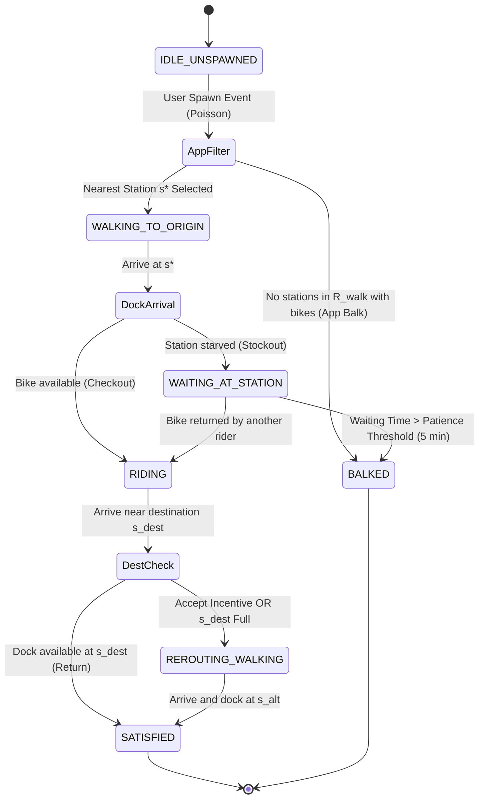

# Simplified Specification Blueprint: Urban Bike-Sharing Fleet Rebalancing & Incentive Optimization

> **Simulation Engine:** Modern Mesa 3.x (`mesa >= 3.0.0`) & SolaraViz  
> **Domain Calibration:** Porto Central Core Micromobility Network  
> **Course Context:** Systems Modelling & Simulation (FEUP MS)

---

## 1. Problem Statement & Formal Optimization

### 1.1 Problem Overview
In an urban electric bike-sharing system (BSS), morning and evening commuting routines produce severe spatial imbalances:
* **Origin Starvation:** Stations in residential zones run out of bikes (`B_i(t) == 0`), forcing commuters to balk immediately.
* **Destination Saturation:** Stations in commercial and university centers reach full capacity (`B_i(t) == C_i`), forcing arriving cyclists to make walking detours to alternative stations.

Physical rebalancing using service vans incurs fuel, labor, and maintenance expenses that are bounded by a municipal operating budget. 

**Core Research Question:**
> "Given a constrained operational budget, what dispatching and rebalancing policy for a fleet of service vehicles minimizes unmet commuter demand caused by spatiotemporal imbalances in an urban bike-sharing network?"

The simulation compares **operator-driven physical van rebalancing** against **crowdsourced commuter incentives** (ride credits for returning to starved stations or picking up from saturated stations).

---

### 1.2 Formal Optimization Problem
The objective is to minimize total unmet commuter demand across a 12-hour shift (`T = 720 minutes`, 07:00–19:00), subject to vehicle capacities, dock limits, walking limits, and a strict budget ceiling.

#### Objective Function:
```
Minimize Total Unmet Demand (Z) across the 720-minute shift:

  Z = Sum of all minutes (t = 1 to 720) of:
        Origin Balks(t)
      + (0.5 × Detour Walking Blocks(t))
      + (0.2 × Waiting Minutes(t))
```

Where:
* `Origin Balks(t)`: Count of commuters who find no available, charged bike within `R_walk` (3 blocks) and immediately balk.
* `Detour Walking Blocks(t)`: Excess walking blocks imposed on cyclists when their target destination station is full (weighted by `gamma_walk = 0.5`, meaning 2 excess detour blocks equal 1 unmet trip unit).
* `Waiting Minutes(t)`: Accumulated wait time of commuters waiting at empty docks before a bike arrives (weighted by `gamma_wait = 0.2`, meaning 5 minutes waiting equal 1 unmet trip unit).

#### System Constraints:
1. **Station Capacity:** `0 <= B_i(t) <= C_i` for all stations `i` and ticks `t`.
2. **Van Payload:** `0 <= L_v(t) <= C_van` (`C_van = 18` bikes) for all vans `v`.
3. **Walking Radius Cutoff:** Commuters only consider stations within `R_walk = 3` blocks from origin. If no station has a bike with `>= 20%` battery, the user balks immediately.
4. **Shift Budget Ceiling:**
   ```
   Cumulative Shift OPEX(t) = 
         (Van Blocks Driven × 0.30 €)
       + (Bicycles Handled  × 0.12 €)
       + (Incentives Paid   × 0.25 €)

   Hard Budget Limit: Cumulative OPEX <= 180.00 EUR
   ```
   When `Cumulative OPEX >= 180.00 EUR`, vans immediately return to the central depot and stop operating, and all user incentive offers are disabled.

---

## 2. System Architecture & Dynamics

### 2.1 Entities & Concrete Attributes
* **Commuters (`People`):**
  * `id` (`int`): Unique commuter identifier.
  * `origin_coord`, `dest_coord` (`Tuple[int, int]`): Continuous/grid coordinates of spawn and target.
  * `assigned_origin_station_id`, `assigned_dest_station_id` (`int`): Selected stations.
  * `current_bike` (`Optional[Bike]`): Pointer to checked out bicycle instance while riding (`None` otherwise).
  * `walking_distance` (`float`): Accumulated walking distance (access walk + detour walk).
  * `waiting_time` (`int`): Accumulated ticks spent waiting at an empty origin station.
  * `patience_threshold` (`int`): Maximum waiting tolerance (default: 5 ticks/minutes).
  * `state` (`CommuterState` Enum): `IDLE_UNSPAWNED`, `WALKING_TO_ORIGIN`, `WAITING_AT_STATION`, `RIDING`, `REROUTING_WALKING`, `SATISFIED`, `BALKED`.
* **Rebalancing Vans:**
  * `id` (`int`): Unique vehicle identifier (2 vans deployed).
  * `position_coord` (`Tuple[int, int]`): Current location on the road network (initializes at depot `(16, 16)`).
  * `max_capacity` (`int`): 18 bicycles cargo limit (`C_van`).
  * `loaded_bikes` (`List[Bike]`): Collection of bicycle instances currently secured in cargo hold.
  * `target_station_id` (`Optional[int]`): Destination station of current dispatch.
  * `target_action` (`str`): `"LOAD"`, `"UNLOAD"`, or `"IDLE"`.
  * `planned_route` (`List[Tuple[int, int]]`): Waypoints along road corridors toward target.
  * `state` (`VanState` Enum): `IDLE_AT_DEPOT`, `EN_ROUTE_PICKUP`, `LOADING_BIKES`, `EN_ROUTE_DROPOFF`, `UNLOADING_BIKES`.
* **Stations:**
  * `id` (`int`): Unique station identifier (0 to 27).
  * `position_coord` (`Tuple[int, int]`): Fixed coordinates at road intersections (`x % 4 == 0 and y % 4 == 0`).
  * `capacity` (`int`): Physical dock berths (`C_i`, 15 to 30 berths).
  * `docked_bikes` (`List[Bike]`): Collection of bicycle instances currently locked in docks.
  * `occupied_docks` (property): Number of docked bikes (`len(docked_bikes)`).
  * `zone_type` (`str`): `"RESIDENTIAL"`, `"CENTRAL"`, or `"UNIVERSITY"`.
  * `cumulative_starvation_time` (`int`): Total minutes spent with `occupied_docks == 0`.
  * `cumulative_saturation_time` (`int`): Total minutes spent with `occupied_docks == capacity`.
* **Bicycles:**
  * `id` (`int`): Unique bicycle identifier (250 bikes total, initialized with 100% SoC).
  * `battery_soc` (`float`): State of charge percentage (`0.0%` to `100.0%`).
  * `is_charging` (`bool`): Active charging flag when docked with `battery_soc < 100.0%`.
* **Road Grid & Manhattan Corridor Routing:**
  * 37 x 37 cell grid (coordinates 0 to 36) composed of 9 x 9 immutable 3 x 3 building blocks bounded on all sides by 1-cell road corridors where `(x % 4 == 0) or (y % 4 == 0)`.
  * **Navigation Rule:** Agents travel strictly along road lines using step corridor routing (e.g., move along avenue to intersection, then along street to target). Diagonal traversal across block interiors is strictly prohibited.

---

### 2.2 Movement Speeds & Battery Kinetics
* **Walking Speed:** 1 block every 3 minutes (3 ticks/block, ~4.5 km/h).
* **Cycling Speed:** 1 block per minute (1 tick/block, ~15 km/h).
* **Van Speed:** 2 blocks per minute (2 blocks/tick, ~30 km/h, twice the speed of a bicycle).
* **Battery Discharge:** Constant 2.0% SoC drain per block ridden.
* **Battery Recharge:** When docked, recharges at 1.0% SoC every 2 minutes (+30% per hour). Bikes with `< 20%` SoC cannot be checked out.

---

### 2.3 Contended Resources & Capacity Rules
1. **E-Bikes:** Checked out at origin from `docked_bikes` (requires `len(docked_bikes) >= 1` and at least one bike with `battery_soc >= 20%`), locked during ride, added to `docked_bikes` at destination. Vans load batches from surplus stations and unload into deficit stations.
2. **Station Docks:** Berth seized upon return or van delivery; released upon checkout or van pickup. Requires `len(docked_bikes) < capacity`.
3. **Mass Conservation:**
   ```
   Next Station Inventory = 
         Current Bikes
       - Commuter Checkouts + Commuter Returns
       + Van Unloads        - Van Loads

   (Clamped between 0 and physical Station Capacity C_i)
   ```

---

### 2.4 System States & State Transitions



---

## 3. Commuter Behavior & Stochastic Generation

### 3.1 Spatial Grid Zoning & Commuter Inflow
The 30 x 30 grid stylistically mirrors the real urban geography of Porto along its cardinal axes:
* **Central Business District (CBD / Baixa):** Sited in the South (lower grid coordinates), representing downtown commercial, tourism, and transit sinks (Aliados, São Bento, Bolhão).
* **University & Hospital Pole (Asprela):** Sited in the North-East, representing the major academic and healthcare hub (FEUP, Hospital de São João).
* **Residential Commuter Belts:** Sited across the North-West and East, representing dense residential origins (Paranhos, Ramalde, Prelada, Bonfim).
* **Central Transit Anchor & Fleet Depot:** Situated at the central intersection linking the north-south transit corridors (Marquês axis).

The 12-hour operational day (720 ticks at 1 min/step) is split into 3 diurnal phases. At each tick, new commuters spawn according to Poisson arrival rates per zone (`np.random.poisson(lam_zone)`):

| Urban Zone | Morning Peak (07:30–09:30) | Midday Off-Peak (09:30–16:30) | Evening Peak (16:30–18:30) |
| :--- | :--- | :--- | :--- |
| **Residential** | `lam = 2.5` users/min | `lam = 0.8` users/min | `lam = 0.5` users/min |
| **Central Business (CBD)** | `lam = 0.5` users/min | `lam = 0.8` users/min | `lam = 2.5` users/min |
| **University / Hospital** | `lam = 0.8` users/min | `lam = 0.8` users/min | `lam = 2.0` users/min |

*(Shoulder hours 07:00–07:30 and 18:30–19:00 use midday baseline rates).*

---

### 3.2 Origin-Destination (O-D) Routing
Spawned commuters sample their destination zone from diurnal transition matrices:
* **Morning Peak (Departing to Work/Study):**
  * From Residential: 65% Central, 25% University, 10% Residential
  * From Central: 70% Central, 15% University, 15% Residential
  * From University: 50% University, 30% Central, 20% Residential
* **Evening Peak (Returning Home):**
  * From Central: 75% Residential, 15% Central, 10% University
  * From University: 70% Residential, 20% University, 10% Central
  * From Residential: 60% Residential, 25% Central, 15% University

---

### 3.3 App-Assisted Origin Selection & Balking
1. Commuter queries all stations within `R_walk = 3` blocks that have at least 1 bike with `battery_soc >= 20%`.
2. **Greedy Choice:** Selects the nearest station with an available bike (ties broken by proximity to destination).
3. **Immediate App Balk:** If no qualified station exists within 3 blocks, the commuter logs an unmet demand balk and immediately exits without walking.
4. **Waiting at Origin:** If bikes are taken during the access walk, the commuter waits up to 5 ticks. If a bike is returned, they unlock it; otherwise, they balk after 5 minutes.

---

### 3.4 Incentive Acceptance Decision
When approaching destination `s_dest`, if an incentive credit is offered to divert to alternative station `s_alt`:
* **Detour Cutoff:** Commuters refuse any detour greater than 2 blocks (`max_detour = 2`).
* **Acceptance Rule:** If detour is <= 2 blocks, commuter accepts with **70% probability** for the standard 0.25 EUR credit. For higher rewards, acceptance scales linearly up to **85%**.

---

## 4. Rebalancing Policies & Incentive Schemes

### 4.1 Van Rebalancing Policies (Policies 0–3)
* **Policy 0: No Rebalancing (Baseline):** Vans remain parked at the depot `(16, 16)`. Measures natural system entropy and baseline unmet demand. Travel OPEX is `0.00 EUR`.
* **Policy 1: Static Periodic Route:** Vans continuously visit stations in ascending order of station ID in repeating circular loops. At each scheduled stop, the driver loads or unloads bikes toward the 50% capacity target (`S_i* = 0.5 * C_i`), constrained by van capacity.
* **Policy 2: Reactive Threshold Dispatching:** Monitored at every simulation tick:
  * *Unload Trigger:* Triggered when `B_i(t) < 0.20 * C_i` (starvation threat). Closest van carrying bikes is dispatched to unload.
  * *Load Trigger:* Triggered when `B_i(t) > 0.80 * C_i` (saturation threat). Closest van with cargo space is dispatched to load toward 50%.
  * *Destination Pairing:* Upon loading bikes at a saturated station, the van's next target is immediately assigned to the nearest starved station (`B_j(t) < 0.20 * C_j`) to unload. If no station is starved, the van returns to the depot.
* **Policy 3: Proactive Schedule-Driven Dispatching:** Knowing peak hours in advance, vans reposition bikes 20 minutes before peak commute surges:
  * At `t = 10` (07:10 AM, pre-morning peak): Vans load surplus bikes from Central and University transit hubs and transfer them to Residential origin stations.
  * At `t = 580` (16:40 PM, pre-evening peak): Vans load surplus bikes from Residential stations and deliver them to Central and University stations.
* *Handling Labor:* Loading or unloading takes 35 seconds per bike (~0.58 ticks; cost: `0.12 EUR / bike`).

---

### 4.2 User Incentive Schemes (Schemes 0–3)
* **Scheme 0: No Incentives:** Commuters always travel to their primary destination.
* **Scheme 1: Flat Credit:** 0.25 EUR credit awarded for returning to a starved station (`< 20%`) or unlocking from a saturated station (`> 80%`).
* **Scheme 2: Dynamic Tiered Bonus:**
  * Base credit: 0.25 EUR.
  * Urgency bonus: +0.15 EUR if station is severely starved (`< 10%`) or saturated (`> 90%`).
  * Detour compensation: +0.10 EUR per additional block walked beyond 1 block.
* **Scheme 3: Hybrid Coordination:** Crowdsourced incentives are active strictly in peripheral Residential zones. Physical vans are dedicated exclusively to Central and University corridors and never enter Residential zones.

---

### 4.3 Performance Evaluation & KPIs
* **Scenario Matrix:** Full 4 x 4 matrix (16 scenarios) evaluated over 30 Monte Carlo random seeds.
* **Primary KPI - Cost Efficiency Ratio:**
  ```
  Cost per Prevented Failure (EUR) = 
        Total Budget Spent (EUR)
      ---------------------------------------------------------
      Unmet Demand (Baseline P0) - Unmet Demand (Current Policy)
  ```
* **Secondary KPIs:**
  * *System Service Level (%):*
    ```
    Service Level (%) = 
             Completed Commuter Trips
      --------------------------------------- × 100%
      Completed Trips + Total Unmet Demand
    ```
  * *Station Starvation & Saturation Duration:* Total minutes spent at `B_i == 0` and `B_i == C_i`.
  * *Average Commuter Detour:* Mean excess blocks walked per diverted rider.
  * *Van Yield:* Repositioned bikes per block driven.

---

## 5. Master Parameters & Calibrated Values

| Parameter | Value | Unit | Description |
| :--- | :--- | :--- | :--- |
| **Grid Dimensions** | `37 x 37` | Cells | 2D city environment (0 to 36) bounded by perimeter roads |
| **Block Size** | `3 x 3` | Cells | 9 x 9 building blocks bounded by roads (`x%4==0 \| y%4==0`) |
| **Total Stations** | `28` | Nodes | Located strictly at road intersections |
| **Station Capacity (`C_i`)**| `15 - 30` | Berths | Physical dock berths per station |
| **Total Bicycle Fleet** | `250` | Bikes | Distributed active fleet (initialized at ~45% capacity, 100% SoC) |
| **Rebalancing Vans** | `2` | Vehicles | Active service fleet (starts at depot `(16, 16)`) |
| **Van Cargo Capacity** | `18` | Bikes | Maximum bicycles onboard a van |
| **Shift Duration** | `12` (720) | Hours (Ticks)| 07:00 to 19:00 operational window (1 tick = 1 min) |
| **Budget Limit (`B_max`)** | `180.00` | EUR | Operational shift spending ceiling |
| **Van Driving Cost** | `0.30` | EUR / block | Fuel, driver wage, and maintenance per block |
| **Handling Labor Cost** | `0.12` | EUR / bike | 35 seconds driver handling time to latch/unlatch |
| **Flat Incentive Reward** | `0.25` | EUR / trip | Credit per diverted commuter drop-off |
| **Van Speed** | `2` | Blocks / tick | ~30 km/h urban driving speed |
| **Cycling Speed** | `1` | Block / tick | ~15 km/h urban riding pace |
| **Walking Speed** | `1 / 3` | Block / tick | 1 block per 3 minutes (~4.5 km/h) |
| **Walking Radius Cutoff**| `3` | Blocks | Maximum access walking distance to origin dock (`R_walk`) |
| **Max Detour Tolerance**| `2` | Blocks | Maximum detour walking accepted for incentives |
| **Patience Threshold** | `5` | Minutes | Maximum wait at empty origin before balking |
| **Objective Weight (Walk)**| `0.5` | Weight | `gamma_walk` penalty per excess detour block |
| **Objective Weight (Wait)**| `0.2` | Weight | `gamma_wait` penalty per minute waiting at docks |
| **Target Fill Ratio** | `0.50` | Ratio | 50% capacity target during rebalancing (`S_i*`) |
| **Starvation Trigger** | `0.20` | Ratio | Low-inventory trigger (20% capacity) |
| **Saturation Trigger** | `0.80` | Ratio | High-inventory trigger (80% capacity) |
| **Battery Discharge** | `2.0%` | SoC / block | Linear drain while riding |
| **Battery Recharge** | `0.5%` | SoC / min | Dock charging rate (+1.0% SoC every 2 min) |
| **Min Operational SoC** | `20.0%` | % | Minimum battery required for commuter checkout |

---

## 6. Implementation Notes & Guidelines

* **Modern Mesa 3.x Conventions:**
  * All agents subclass `mesa.Agent` and call `super().__init__(model)`.
  * Legacy schedulers (`RandomActivation`, `BaseScheduler`) are prohibited. Use `self.agents_by_type[CommuterAgent].shuffle_do("step")`, `self.agents_by_type[VanAgent].shuffle_do("step")`, and `self.agents_by_type[StationAgent].do("step")`.
  * Filter collections using native `AgentSet` functions (`select`, `filter`) rather than manual loops.
  * Collect metrics via `mesa.DataCollector`.
* **SolaraViz Dashboard Specification:**
  1. **Animated Grid Canvas:** 30 x 30 cell grid displaying road corridors and background zone colors. Stations drawn with fill glyphs (Green if `20% <= fill <= 80%`, Red if `< 20%` or `> 80%`). Commuters rendered as color-coded dots (walking vs. riding). Vans rendered as vehicle icons displaying current payload (`L_v / 18`).
  2. **Interactive Runtime Controls:** Dropdown menus allowing dynamic runtime selection of `Van Policy` (0–3) and `Incentive Scheme` (0–3). Play/Pause, Step button, and execution speed slider (1 to 60 steps/second).
  3. **Header Clock & Status Panel:** Displays 12-hour clock (07:00–19:00), active phase (`Morning Peak`, `Midday`, `Evening Peak`), cumulative OPEX counter (`spent / 180.00 EUR` with exhaustion badge), and total unmet demand.
  4. **Live Real-Time Charts:** Real-time streaming line plot of cumulative OPEX vs. 180 € ceiling, and active starved/saturated station counts.
* **Batch Runner Experiments:**
  * Headless parameter sweeps using `mesa.batch_run` parallelized over CPU cores, executing 30 iterations for each of the 16 scenario combinations to export CSV metrics for statistical validation.

---

## 7. Phased Implementation Roadmap

* **Step 1 - Urban Spatial Grid, Zoning & Road Network:**
  Construct the 37 x 37 spatial grid environment (coordinates 0 to 36), defining 9 x 9 immutable 3 x 3 building blocks, perimeter road corridors along block boundaries where `(x % 4 == 0) or (y % 4 == 0)`, and categorical urban zones reflecting Porto's cardinal morphology (South: Central/Baixa, North-East: University/Asprela, West: University/FCUP, and surrounding Residential). Implement Manhattan corridor road navigation ensuring all agent movements are strictly restricted to road coordinates with zero diagonal traversal through blocks.

* **Step 2 - Docking Station Infrastructure & Capacity Management:**  
  Instantiate 28 docking stations placed exclusively at road intersections, initializing dock berths between 15 and 30 docks per station. Implement dock occupancy tracking via `docked_bikes` list, check-in and check-out capacity bounds (`0 <= len(docked_bikes) <= C_i`), and monitoring for station starvation (`occupied_docks == 0`) and saturation (`occupied_docks == C_i`) durations.

* **Step 3 - E-Bike Fleet, Battery Dynamics & Charging Lifecycle:**  
  Initialize the fleet of 250 electric bicycles distributed across stations (~45% capacity, 100% SoC), tracking individual battery State of Charge (`0.0%` to `100.0%`). Implement a constant 2.0% battery discharge per block ridden, linear dock recharging (+1% SoC every 2 minutes), and enforce the operational cutoff rule preventing bikes with less than 20% charge from being unlocked by commuters.

* **Step 4 - Commuter Spawn, Zoning OD Demands & App Decision Logic:**  
  Generate commuter arrivals according to time-phased Poisson arrival rates per zone and sample trip destinations using diurnal origin-destination transition matrices for morning and evening peaks. Implement pre-trip app logic that checks stations with charged bikes within a 3-block walking radius, greedily selects the nearest valid origin dock, or logs an immediate app balk if no stations qualify.

* **Step 5 - Commuter Trip Execution, Riding Kinetics & Detour Handling:**  
  Model commuter progression from walking to unlocking a bike, cycling along road networks at 1 block/minute toward the destination dock, and handling destination saturation. If the target dock is full upon arrival, simulate detour walking to alternative nearby stations and log excess detour distance, wait times, and total unmet demand.

* **Step 6 - Economic Engine, OPEX Accounting & Shift Budget Enforcement:**  
  Implement real-time operational expenditure tracking accounting for van travel (`0.30 EUR/block`), bike handling labor (`0.12 EUR/bike`), and incentive payouts (`0.25 EUR/trip`). Enforce the strict 180.00 EUR shift budget ceiling, automatically returning vans to the depot `(16, 16)` and disabling incentive programs if the cap is reached.

* **Step 7 - Rebalancing Van Fleet Logistics & Cargo Servicing:**  
  Deploy the service fleet of 2 rebalancing vans with physical capacities of 18 bicycles each stored in `loaded_bikes`, driving at 2 blocks/minute strictly along road corridors from depot `(16, 16)`. Implement vehicle routing, batch loading at surplus stations, and batch unloading at deficit stations, accurately accounting for physical handling delays (35s per bike) and vehicle capacity bounds.

* **Step 8 - Van Dispatching Policies:**  
  Implement the modular rebalancing policies: baseline inactive fleet at depot (Policy 0), fixed circular schedule visiting stations in ascending ID order (Policy 1), reactive threshold dispatching triggered when stations reach `< 20%` or `> 80%` capacity with nearest-starved pairing (Policy 2), and proactive schedule-driven dispatching that repositions bikes 20 minutes before peak commute surges (Policy 3).

* **Step 9 - Crowdsourced User Incentive Schemes & Hybrid Coordination:**  
  Implement commuter incentive mechanisms: baseline without incentives (Scheme 0), flat credit of 0.25 EUR (Scheme 1), dynamic tiered bonus scaling with station deficit and detour length (Scheme 2), and hybrid coordination where incentives handle peripheral residential zones while service vans target central arterial corridors (Scheme 3).

* **Step 10 - Interactive Dashboard, Verification Battery & Batch Experiments:**  
  Integrate an interactive SolaraViz dashboard featuring live grid animations with color-coded station fill gauges, runtime policy dropdowns, clock controls, and real-time budget plots. Implement an automated invariant verification test suite and configure multi-core batch runs across the 4 x 4 scenario matrix with 30 replications to evaluate cost efficiency and service levels.

---
*End of Simplified Blueprint Specification.*
